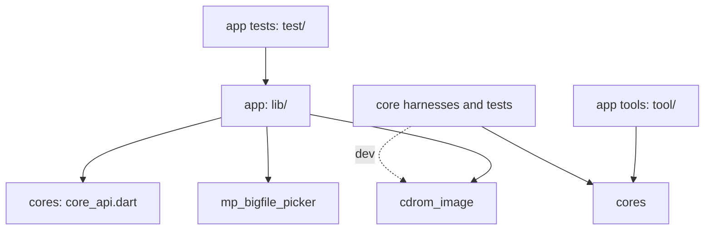
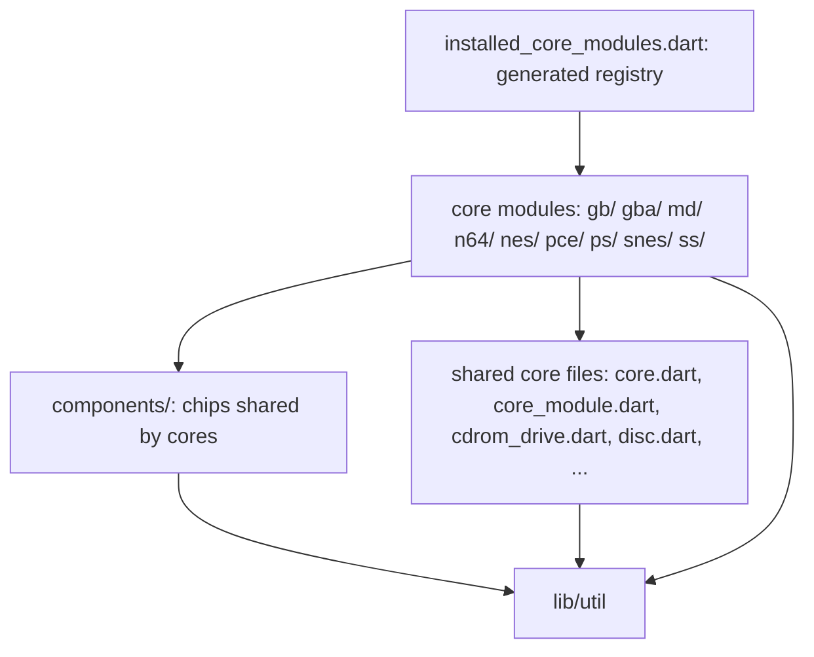

# Architecture

The design rules of fnesemu: what each part owns, and which way the
dependencies go. A dependency against these arrows is a bug, even if it
compiles.

## Parts

| Part | Where | Runtime | Owns |
|---|---|---|---|
| cores | `packages/fnesemu_core` (`lib/core`, `lib/util`) | pure Dart | the emulation; which system a ROM or a disc is; the BIOS setup |
| cdrom_image | `packages/cdrom_image` | pure Dart, no dependencies | the disc image formats (.cue/.iso/.bin) on a virtual file system: which files are images, the files a .cue refers to, the TOC, async reads by LBA |
| mp_bigfile_picker | `packages/mp_bigfile_picker` | Flutter plugin | picking files and directories on each platform, and random access to them |
| app | `lib/` (`main.dart`, `gui/`) | Flutter | the GUI, the storage, and the glue between the parts |
| core harnesses | `packages/fnesemu_core/tool` | Dart VM (dart:io) | running the cores headless: regressions, benchmarks, CPU tests |
| app tools | `tool/` | Flutter / dart:io | tools which need the app's dependencies (audio output, Flutter) |

## Dependencies

Only these arrows exist:

- **cores** depend on nothing but the Dart SDK (no Flutter, no dart:io, no
  other package). They know neither the app nor cdrom_image nor the picker.
- **cdrom_image** depends on nothing but the Dart SDK (no dart:io either). It
  does not know the cores or the picker: it defines its own file interfaces
  (`DiscFile`, `DiscDirectory`) and is given the files.
- **mp_bigfile_picker** does not know the other parts.
- **the app** depends on all three, and is the only part which connects them.
- **core harnesses and core tests** depend on the cores, and on cdrom_image as
  a dev dependency to read disc images. They never depend on the app.
- **app tests** depend on the app.

## Interfaces between the parts

Each part shows an interface, and the app adapts one to another.

- **cores to the app**: `package:fnesemu_core/core/core_api.dart` only (and
  `util/`). The app never imports a concrete core, a core-specific ID or
  format. `test/gui/core_boundary_test.dart` checks the imports of `lib/gui`.
- **discs to the cores**: the cores read a disc only through `CdromDrive`
  (`core/cdrom_drive.dart`): the tray state, the TOC, and synchronous polling
  of raw sectors by LBA. A core identifies its system from a `CdromDrive`
  (`CoreModule.identifyDisc`), and does not know .cue/.iso/.bin.
- **files to cdrom_image**: `DiscFile` (random read) and `DiscDirectory` (walk
  and open). cdrom_image returns `DiscImage` (TOC, `readSectors(lba, count)`),
  `DiscFolder.parse` (an image file and the files it refers to) and
  `DiscFileKind` (whether a name can be an image).

The glue in the app:

- `lib/gui/picked_disc.dart`: the picker's `RandomReadFile` /
  `PickedDirectory` as cdrom_image's `DiscFile` / `DiscDirectory`.
- `lib/gui/async_cdrom_drive.dart`: the cores' `CdromDrive` on a `DiscImage`,
  with read-ahead and cache. How a disc is read in the GUI is the app's
  choice.
- `lib/gui/rom_scanner.dart`: the ROM files of a picked ROM directory, which
  excludes the files a .cue refers to (`DiscFolder.parse`).
- `lib/gui/app.dart`: whether a selected file is a disc (`DiscFileKind`,
  then `CoreFactory.systemOfDisc`) or a ROM (`CoreFactory.findRom`).

The core harnesses have their own small glue, as they cannot import the app:
`tool/local_disc.dart` (dart:io files as `DiscFile`) and
`tool/cdrom_drive.dart` (`SimpleCdromDrive`, a deterministic drive without
read-ahead or cache).

## Between the cores

`packages/fnesemu_core/lib/core` has three layers, and a file imports only
its own layer or the ones below it:

- **A core module never imports another core module.** md does not import ss,
  ss does not import md, and so on. This is what lets any core be omitted.
- **Shared core files** (`lib/core/*.dart`: the `Core` and `CoreModule`
  interfaces, `CoreController`, `CdromDrive`, `Disc`, `DiscSwapWatcher`,
  `media_input.dart`, `Sram`, `PadButton`, ...) are the contracts and the
  helpers every core may use. They never import a module or a component.
  `CoreFactory` reaches the modules only through the registry.
- **Components** (`lib/core/components/<chip>`) are chips used by more than one
  core, e.g. `components/m68k` (the 68000 of md and of the ss sound CPU). A
  component depends only on `lib/util` and its own files, and talks to its
  core through its own interfaces (e.g. a bus), not the core's classes.
- **When a second core needs a chip**, move it from the first core into
  `components/` instead of importing it across modules. A copy is allowed
  only while the two versions are meant to diverge, and is noted in the code
  (ss/sh2 is a copy of md/32x/sh2 with the ss extensions).
- **The registry** (`installed_core_modules.dart`) is the only file which
  imports the modules (`<module>/module.dart`), and it is generated.
- The app reaches a core only through its `CoreModule` and the `Core`
  interface. Only the core harnesses and the core tests may use a module's
  own classes (e.g. `Ps`, `Nes`) directly.

## Core registration

- Core modules (`lib/core/<module>/module.dart`) declare their systems, BIOS
  setup, and how they identify ROMs and discs. `CoreFactory` enumerates the
  registered modules and only delegates to them.
- The registration list is generated, separately from the app:
  `cd packages/fnesemu_core && dart run tool/generate_core_registry.dart`
  after adding or removing a module. The app does not change for it, and
  must build and run with any core omitted, including an empty registry.

## Tests

- Each test lives in the part it tests, and uses only what that part may
  depend on:
  - `packages/fnesemu_core/test`: `dart test`. Tests of the cores, and of the
    core harnesses (`test/tools`).
  - `packages/cdrom_image/test`: `dart test`. The formats, on the memory file
    system (`package:cdrom_image/memory.dart`).
  - `test/`: `flutter test`. The GUI and the glue, through `core_api.dart`.
    App tests do not run concrete-core logic; a test which needs a core's
    behavior belongs to the cores.
- `make test` runs all three; CI runs the same.
- Screenshot and audio regressions run the core harnesses
  (`scripts/regress.py`, see `docs/TEST.md`).
- The rules are checked by tests: `test/gui/core_boundary_test.dart` (the app
  and its tests import only `core_api.dart`) and
  `packages/fnesemu_core/test/core/core_layers_test.dart` (the layers between
  the cores).
